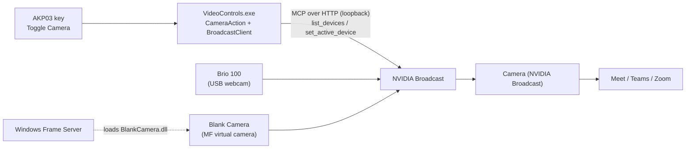

# Blank Camera: camera key via NVIDIA Broadcast

Implementation plan · 2026-11-10

## Goal

The **Toggle Camera** key will blank your video in any call by switching NVIDIA Broadcast's source from
the Brio 100 to a new virtual camera, **Blank Camera**, and back again on the next press. There's no admin
prompt per press, and the call never loses its camera.

- **Why the current key fails:** it flips the Windows camera privacy setting. Meet uses the
  "Camera (NVIDIA Broadcast)" virtual camera, which that setting doesn't cover. A stream that's already
  open isn't cut either.
- **What changes for you:** press once and Meet keeps receiving video, but it shows the Blank Camera picture.
  Press again and your camera is back. The key colour is read from Broadcast itself, so it can't drift out
  of sync.
- **Scope:** the Video Controls plugin (`videocontrols/`, its own build and install) plus a new native DLL.
  Audio Controls is untouched.

## Findings that drive the design

| Fact | Detail | Consequence |
|---|---|---|
| All meetings go through NVIDIA Broadcast | Meet's camera is "Camera (NVIDIA Broadcast)", fed by the Brio 100 | Blanking must happen at Broadcast's input or in Broadcast itself |
| Broadcast 2.3.0.13104 has a local control server | MCP over HTTP at `http://127.0.0.1:<port>/gateway`; port in `%APPDATA%\nvidia-broadcast\gateway.json` (base64 JSON `{"port":…}`); default 18100, range 18100-18109; no auth, loopback only | The plugin can read and change Broadcast's state without admin rights |
| The gateway has no "camera off" option | Tools: `list_devices`, `set_active_device`, `set_effects`, `get_broadcast_state`, …; `set_active_device` only accepts an ID from `list_devices` | We need a second camera for Broadcast to switch to |
| Only one camera is present | Brio 100, `USB\VID_046D&PID_094C&MI_00\…`, active at 1920x1080@30 | The second camera has to be a virtual one |
| Current Broadcast effects | Background replace **on** (`Meeting Background_2026_Option 6.png`), auto frame **on**, mic noise removal on | With no person in frame, background replace may show the background image rather than black (see Risks) |
| Windows 11 build 26300 | Has `MFCreateVirtualCamera` (Windows 11 22000+) | A driverless software camera is possible |
| Toolchain | Visual Studio Community 2026 installed **without** the C++ workload or a Windows SDK; .NET SDK 10.0.403 present | The C++ workload must be installed first |

## Architecture



- **Press while live:** the plugin asks Broadcast which camera is active, remembers it and its resolution,
  then calls `set_active_device` with the Blank Camera's ID. The key turns red.
- **Press while blank:** the plugin switches Broadcast back to the remembered camera and resolution.
  The key turns green.
- **Every few seconds:** the plugin reads `list_devices` and colours the key by which camera is active.
  A camera switched by hand in Broadcast's window shows up on the key too.
- Meet only ever sees "Camera (NVIDIA Broadcast)", which never goes away.

## Component 1: Blank Camera DLL (C++)

A COM in-process media source that Windows' Frame Server loads to produce the Blank Camera's frames.

- **Base:** Microsoft's open-source VirtualCamera sample
  ([microsoft/Windows-Camera, Samples/VirtualCamera](https://github.com/microsoft/Windows-Camera/tree/master/Samples/VirtualCamera)),
  specifically its simple media source project. Strip it down to one stream of solid frames.
- **Interfaces** (as in the sample): `IMFActivate` for activation, then `IMFMediaSourceEx` with `IKsControl`,
  plus one `IMFMediaStream2`. Every buffer is filled with black.
- **Formats offered:** NV12 at 1920x1080@30 and 1280x720@30, matching what the Brio offers Broadcast, so
  switching doesn't force a resolution change. RGB32 can be added if Broadcast refuses NV12.
- **Picture:** phase 1 is solid black. A later option is a "Camera off" card, with a PNG path read from the
  registry and decoded once with WIC.
- **Identity:** its own CLSID (new GUID), friendly name "Blank Camera", registered with
  `ThreadingModel=Both` under HKLM.
- **Location:** `%ProgramFiles%\VideoControls\BlankCamera\BlankCamera.dll`. Frame Server runs as LOCAL
  SERVICE and can't read files in your user profile. Program Files is also admin-only for writing, so no
  unprivileged process can swap the DLL.
- **Camera registration:** a small companion `BlankCamSetup.exe install|uninstall` calls
  `MFCreateVirtualCamera` (header `mfvirtualcamera.h`, lib `mfsensorgroup.lib`) with
  `MFVirtualCameraType_SoftwareCameraSource`, `MFVirtualCameraLifetime_System`,
  `MFVirtualCameraAccess_AllUsers`, the friendly name and the CLSID, then `Start()`. System lifetime means
  the camera persists across reboots, so the plugin needs no native code at all.
- **Side effect:** "Blank Camera" also appears in other apps' camera lists, such as Meet's own picker.
  That's harmless, and it can be uninstalled with `BlankCamSetup.exe uninstall`.

## Component 2: plugin changes (C#)

Everything stays C# 5 / .NET Framework 4.x so it still compiles with the `csc.exe` built into Windows.

### New `src/Broadcast.cs`: gateway client

- `Port()`: reads and base64-decodes `gateway.json` on every connect attempt; never cached across failures.
- `Connect()`: POST `initialize` (protocol `2025-06-18`), keep the `Mcp-Session-Id` response header, then
  send `notifications/initialized`. **Refuse to continue unless `serverInfo.name == "nvidia-broadcast"`.**
- `Call(tool, args)`: POST `tools/call` with `Accept: application/json, text/event-stream`. The body is
  either plain JSON or SSE; take the last `data:` line. Return `result.structuredContent`.
- On HTTP 404/400 for the session, or a connection failure: reconnect once, then report "Broadcast unavailable".
- Tool errors: `-32603` with `retryable:true` retries once after 500 ms; `-33102`/`-33103` (rate limits)
  back off; `-32602` is logged and shows the alert.
- HTTP via `HttpWebRequest` (no extra references); JSON via the existing `JavaScriptSerializer`.

### Reworked `src/CameraAction.cs`

- **States** (manifest unchanged): 0 = live (green), 1 = blank (red).
- **keyDown:**
  1. Ignore the press if a switch is already in flight; `set_*` calls are throttled.
  2. Call `list_devices {"kind":"camera"}`. Find Blank Camera by name, and the active camera.
  3. If a real camera is active, save its `id` and `currentResolution`, then call
     `set_active_device {kind:"camera", deviceId:<blank id>}`.
  4. If Blank Camera is active, call `set_active_device` with the saved ID plus width, height and frameRate.
     With nothing saved (e.g. after a restart), use the first camera that isn't Blank Camera.
  5. Check `deviceConfirmed`, set the key state, and show the alert on any failure.
- **Poll:** `list_devices` every 3 s (not every 1 s, to stay well inside the read limits). Set the state from
  which camera is active. If Broadcast is unreachable, leave the key as is.
- **Settings:** the remembered real camera is saved through `setSettings`, so it survives restarts.
  No settings panel is needed for one camera.
- **Optional, decided after the spike:** turn background replace off while blank and restore it after, via
  `set_effects` with the previous state from `get_broadcast_state`.

### Removed

- `src/Camera.cs` (registry privacy toggle) and its README section. The privacy approach can't reach
  Broadcast's camera, so it isn't kept as a fallback.

### Docs

- README: replace the Toggle Camera section with the Broadcast behaviour, the one-time setup, and the
  troubleshooting entries "Broadcast not running" and "Blank Camera missing from Broadcast".

## Setup and install

1. **Toolchain (once):** in the Visual Studio Installer, add **Desktop development with C++** with the
   Windows 11 SDK. That's a few GB.
2. **Build:** a new `build-blankcam.bat` calls `vcvars64.bat`, then builds `BlankCamera.dll` and
   `BlankCamSetup.exe` from `blankcam/` with `cl`/`link`. It's separate from `build.bat`, so the plugin
   still builds without the C++ tools.
3. **Install the camera (once, one admin prompt):** `setup-blankcam.bat` self-elevates
   (`powershell Start-Process -Verb RunAs`), then:
   1. copies the DLL to `%ProgramFiles%\VideoControls\BlankCamera\`
   2. runs `regsvr32 /s BlankCamera.dll`
   3. runs `BlankCamSetup.exe install`
4. **Broadcast:** restart NVIDIA Broadcast if it doesn't list Blank Camera straight away.
5. **Plugin:** `videocontrols\install.bat`. No admin rights.
6. **Uninstall:** `setup-blankcam.bat uninstall` reverses step 3.

New repository layout:

```
videocontrols/
  blankcam/            C++ sources: media source, class factory, BlankCamSetup.exe
  build-blankcam.bat
  setup-blankcam.bat
  src/Broadcast.cs     new
  src/CameraAction.cs  reworked
  src/Camera.cs        removed
```

## Milestones

Do the spike first: it settles the two unknowns before any real code is written.

1. **Toolchain:** install the C++ workload and Windows SDK.
2. **Spike (go/no-go):** build Microsoft's VirtualCamera sample unmodified, register it and create the
   camera. Check:
   - it shows in the Windows Camera app
   - Broadcast's `list_devices` lists it
   - `set_active_device` to it works, and back again
   - what Meet shows with background replace and auto frame on
   - how long a switch takes in each direction

   If Broadcast doesn't list it, stop and go to the fallbacks under Risks.
3. **Blank Camera DLL:** strip the sample down to black NV12 frames, with its own CLSID and name, plus
   `BlankCamSetup.exe`.
4. **Setup scripts:** `build-blankcam.bat` and `setup-blankcam.bat` (install and uninstall).
5. **Plugin:** `Broadcast.cs`, rework `CameraAction.cs`, remove `Camera.cs`, update the README.
6. **Test pass:** the plan below, then commit.

## Test plan

| # | Scenario | Expected |
|---|---|---|
| 1 | Press during a Meet call | Others see the blank picture within ~2 s; Meet still shows your camera as on; key red |
| 2 | Press again | Your video returns at the same resolution (1080p30); key green |
| 3 | Switch camera by hand in Broadcast's window | Key follows within 3 s |
| 4 | Press with Broadcast closed | Warning triangle; the log says Broadcast is unavailable; key colour unchanged |
| 5 | Restart Broadcast while blank | Key stays red; the next press restores the Brio |
| 6 | Restart Stream Dock while blank | Key red on load; the next press restores the Brio (saved setting) |
| 7 | Mash the key 5 times quickly | No errors, no rate-limit failures; ends in a consistent state |
| 8 | Reboot | Blank Camera still exists; key works without re-running setup |
| 9 | Teams and Zoom as well as Meet | Same as test 1 |
| 10 | Uninstall Blank Camera | Removed from Broadcast and other apps; key shows the alert on press |

## Risks and open questions

- **Broadcast may not list virtual cameras.** This is the biggest unknown and is checked in the spike.
  Fallbacks:
  1. Disable the Brio via a one-time elevated scheduled task (no prompt per press), if Broadcast shows a
     blank or placeholder frame rather than a frozen one.
  2. Send Meet's Ctrl+E shortcut (no state feedback).
- **Background replace on a blank feed** may show the meeting background image instead of black.
  Acceptable, or handled with the optional `set_effects` toggle; decide after the spike.
- **Switch time:** `set_active_device` restarts Broadcast's pipeline. If switching back takes several
  seconds, the key should show the target state immediately and confirm afterwards.
- **Frame Server loading the DLL:** it must be readable by LOCAL SERVICE; we install to Program Files for
  that reason. Is code signing required? Expected not, but unconfirmed until the spike.
- **Gateway port moves** when 18100 is taken: handled by re-reading `gateway.json` on every reconnect.
- **The gateway is unauthenticated on loopback:** any local process could control Broadcast. That's
  Broadcast's design; the plugin only verifies the server name before sending anything.
- **Broadcast updates** could change the tool contract (reviewed 2026-08-14 for 2.3). The client tolerates
  extra fields and logs unknown errors.
- **Open question:** black, or a "Camera off" card? Black ships first.

## References

- NVIDIA Broadcast gateway docs installed locally:
  `C:\Program Files\NVIDIA Corporation\NVIDIA Broadcast\skills\nvidia-broadcast\references\`
  (`connection.md`, `mcp-tool-contract.md`)
- [MFCreateVirtualCamera](https://learn.microsoft.com/en-us/windows/win32/api/mfvirtualcamera/nf-mfvirtualcamera-mfcreatevirtualcamera)
- [Windows-Camera VirtualCamera sample](https://github.com/microsoft/Windows-Camera/tree/master/Samples/VirtualCamera)
